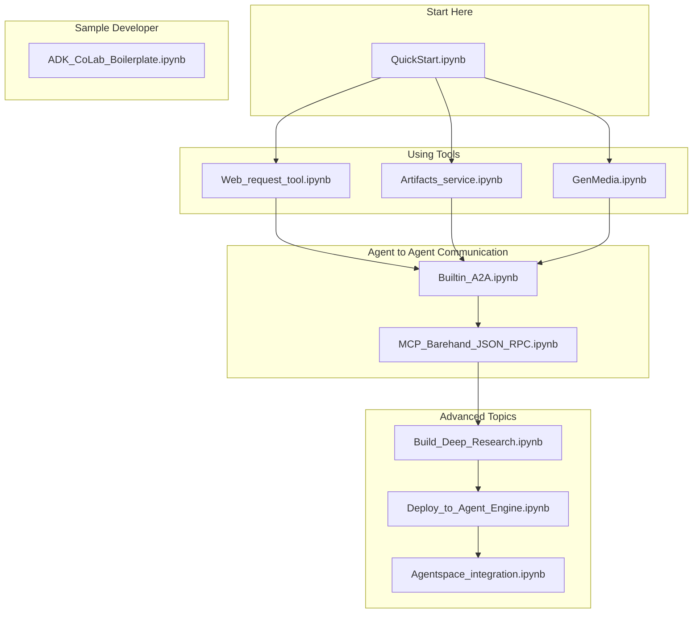

# 101 for Google ADK

This repo includes:

- CoLab to walk through basic concepts
- Off the shelf sample agents for quick experimentation

Notebooks:

1. QuickStart
2. Deploy to Agent Engine
3. Build Deep Research

## Wishlist

- Agent Engine Memory Bank. ( [apply for allowlist here](https://docs.google.com/forms/d/e/1FAIpQLSe6Qn0rQKK9Qa-zOzHI0YSmero9yXPb1ideJFtGXFqpvQL2sA/viewform) )
- A2A Samples
- Agent Engine deployment samples
- Agentspace integration samples
- Working with MCP
- Meta Agent

## Learning paths

